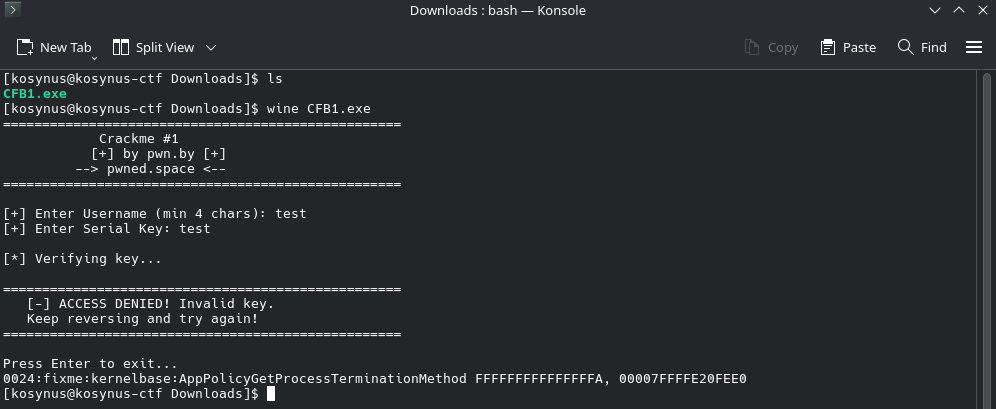
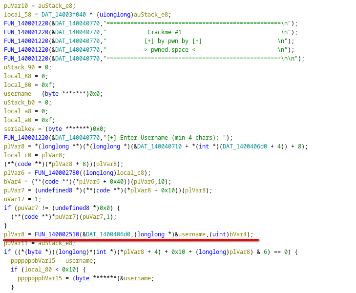
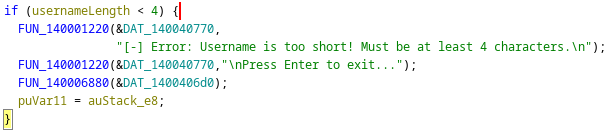
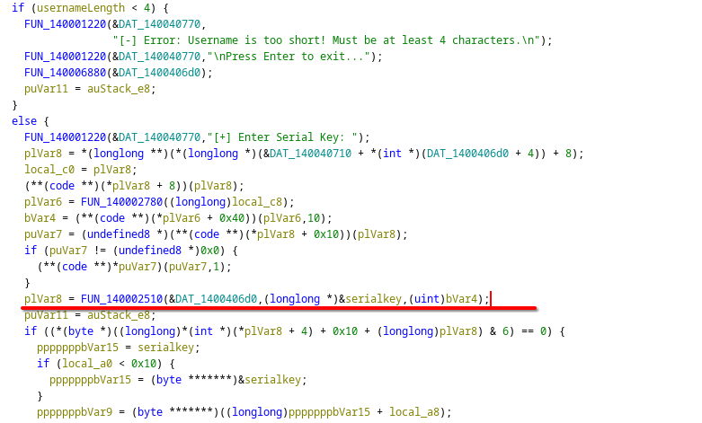
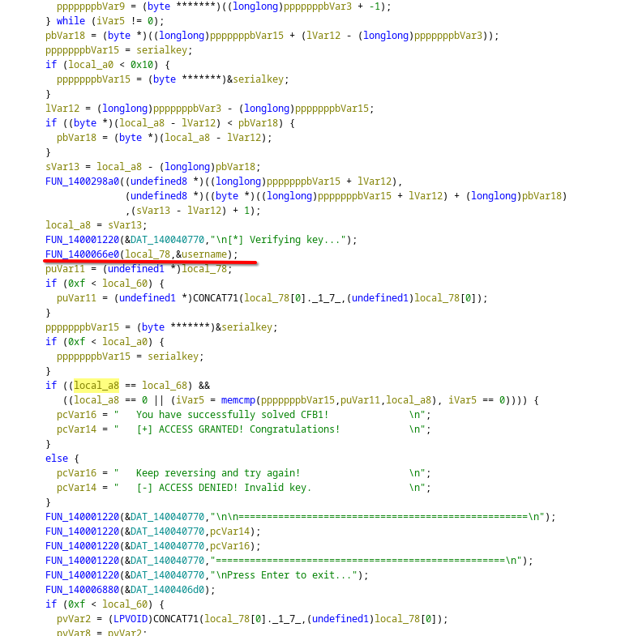
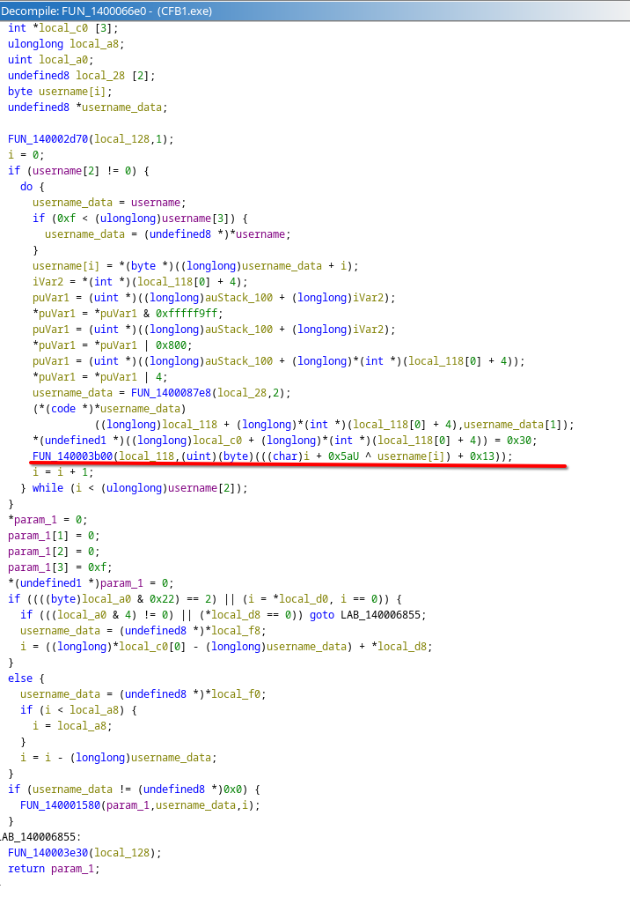
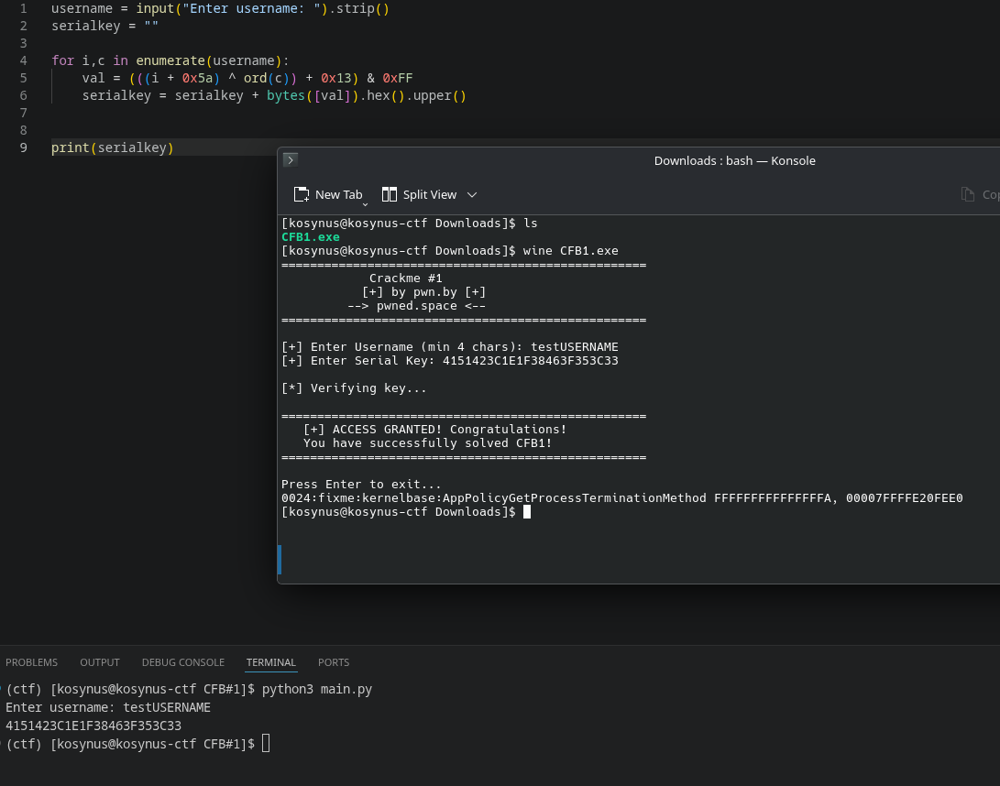

**Platform:**  crackmes.one
**Category:**  Keygen
**Difficulty:**  2.3
**Date:** 2026-09-14  
**Tags:** keygen

---

## Overview
This is the first challenge from the Crackmes for Beginners (CFB) series. It is a simple Username -&gt; Serial keygenme designed for newcomers. There are no hardcoded string passwords to find in memory; instead, you'll need to reverse-engineer a basic mathematical loop to write a keygen solver. - the description of the challange

## Reconnaissance

Ok first we run our program lets see what it is:



Wine because endeavourOS, after I loaded it into ghidra I could easily find the main code of the program, being so verboose I could easily search for reference strings. In the main code of the program there was so much boilerplate code but luckily after every print the variables that were important to us we're being read there, I will attach some print screens in order to make an idea where these variables lay, I also renamed them to make the code more easier to read



Below the username being read there is some code that does some calculations, computes the length of the username and some other checks because ghidra cant recognize `std::string`, there is also a condition that the username has to be atleast 4 characters long



Going on, after the check is made, the serial key is being read and again, more boilerplate code that we can ignore



And at the end the final checks for the serial key and we can see that the check is based on the username, meaning that the key can be generated off the username



Checking out this function and after renaming some variables, we can easily find how the serial key is computed:



`(i+0X5A) ^ username[i] + 0x13`, where i is iterating trough username, the function `FUN_140003b00` that is underlined uppercases the result of that computation
## Flag 

Below I've written the code in python that generates the serial key for any username given:

```python
username = input("Enter username: ").strip()
serialkey = ""  

for i,c in enumerate(username):
	val = (((i + 0x5a) ^ ord(c)) + 0x13) & 0xFF
	serialkey = serialkey + bytes([val]).hex().upper()

print(serialkey)
```

`& 0xFF` at the end because the result can sometimes overflow 1 byte (255) 


