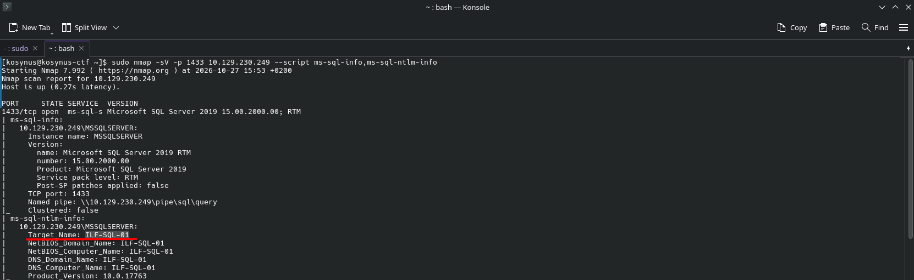
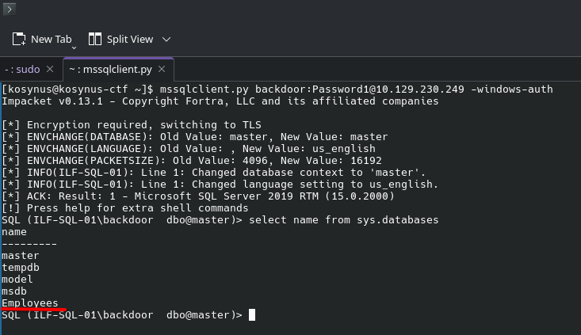

**Platform:**  HackTheBox Academy
**Category:**  Footprinting
**Difficulty:**  Easy
**Date:** 2026-10-27  
**Tags:** footprinting, htb academy, mssql

---

## Reconnaissance

1.  Enumerate the target using the concepts taught in this section. List the hostname of MSSQL server.

We will use `nmap` for this job

2.  Connect to the MSSQL instance running on the target using the account (backdoor:Password1), then list the non-default database present on the server.

Remember that MSSQL runs on a windows machine, so we will use `impacket` to make this connection possible

## Flag / Root

1. `ILF-SQL-01`
2. `Employees`