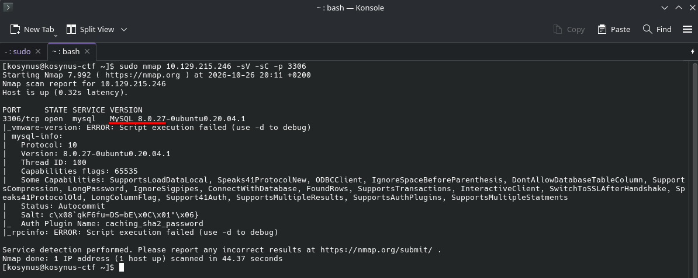
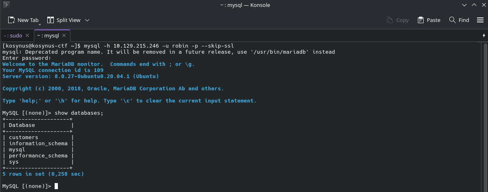
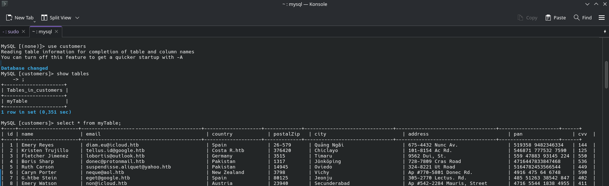
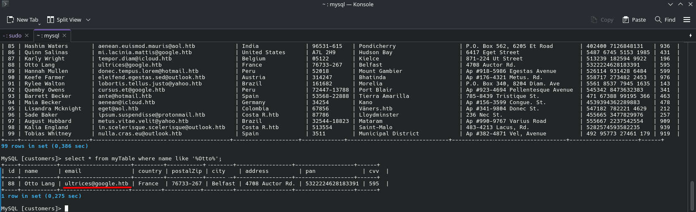

**Platform:**  HackTheBox Academy
**Category:**  Footprinting
**Difficulty:**  Easy
**Date:** 2026-10-26  
**Tags:** footprinting, htb academy

---

## Reconnaissance

1. Enumerate the MySQL server and determine the version in use. (Format: MySQL X.X.XX)

For this we will use nmap 

After the scanning is done, we can easily see the mysql version, follow the format.

2. During our penetration test, we found weak credentials "robin:robin". We should try these against the MySQL server. What is the email address of the customer "Otto Lang"?

We will connect to the mysql database using the provided credentials first and we will display the databases available

We will assume that the database containing customers is the one named `customers`

We were right, after printing the table, it shows 99 records, it is not that much, either we can manually search for the given name or let mysql do the search for us

## Flag / Root

1. `MySQL 8.0.27`
2. `ultrices@google.htb`