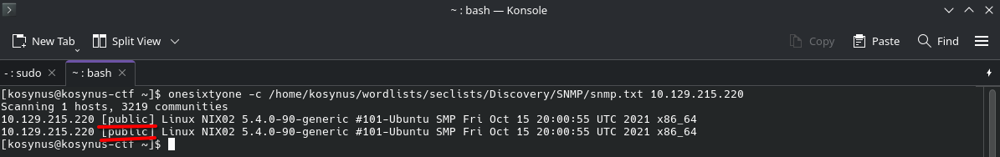
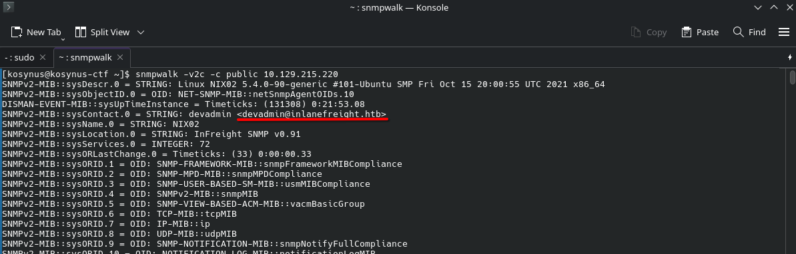
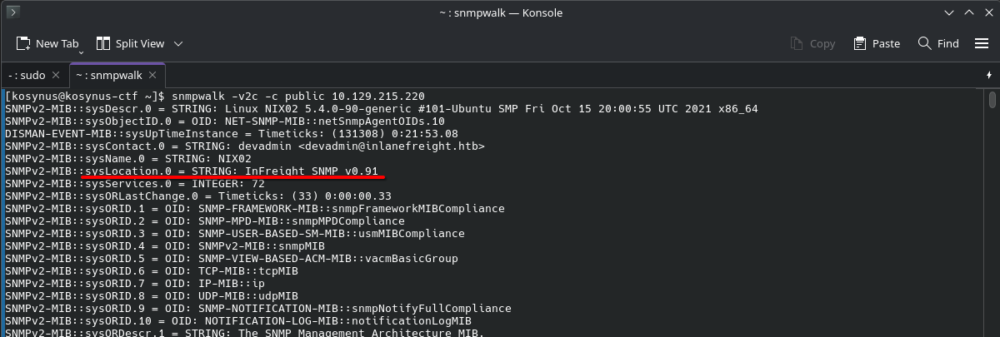
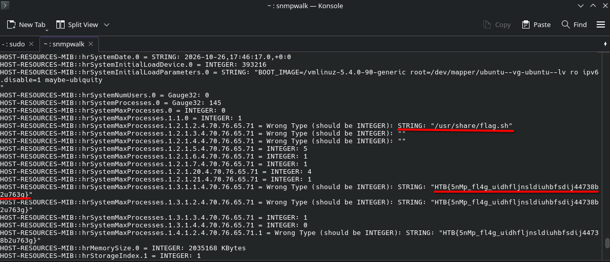

**Platform:**  HackTheBox Academy
**Category:**  Footprinting
**Difficulty:**  Easy
**Date:** 2026-10-26  
**Tags:** footprinting, htb academy

---

## Overview
We will be solving the questions of the SNMP module after carefully reading it.

## Reconnaissance
1. Enumerate the SNMP service and obtain the email address of the admin. Submit it as the answer.
First before doing that we need to find the community string, which is the password for communicating with the SNMP agent, if we dont have that password the agent will not answer to our querries, we will bruteforce it using `onesixtyone` and `SecList` 

From this we know that the community string is the generic one, which is `public`, we will use this to now enumerate the snmp service and obtain the email address.

2. What is the customized version of the SNMP server?
We can find this still by using `snmpwalk`, in the image above if we look at `sysLocation.0` we can see the exact version of the snmp server

3. Enumerate the custom script that is running on the system and submit its output as the answer.
Leaving the `snmpwalk` do its job, after looking into the output of this command, it is easy to see that there is a flag here

The name of the custom script is `flag.sh` and the output is the `HTB{...}` 
## Flag / Root

1. `devadmin@inlanefreight.htb`
2. `InFreight SNMP v0.91`
3. `HTB{5nMp_fl4g_uidhfljnsldiuhbfsdij44738b2u763g}`