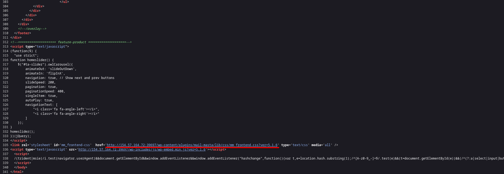
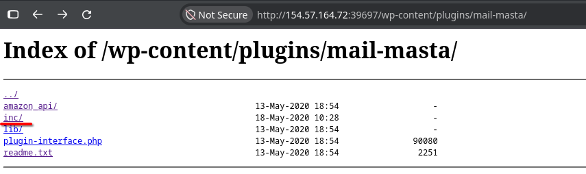
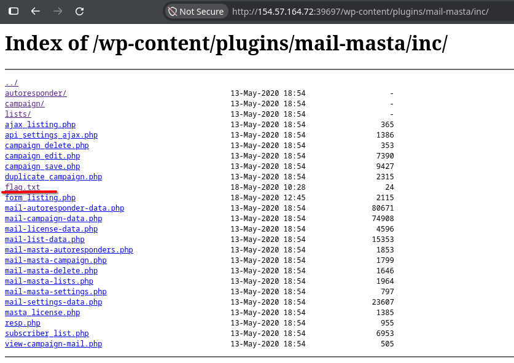
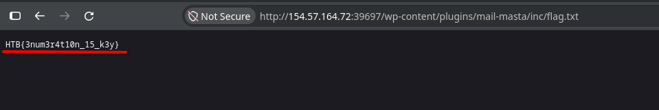

**Platform:**  HackTheBox Academy
**Category:**  Hacking WordPress
**Difficulty:**  Easy
**Date:** 2026-11-08  
**Tags:** hacking wordpress, htb academy

---

## Reconnaissance

1. Keep in mind the key WordPress directories discussed in the WordPress Structure section. Manually enumerate the target for any directories whose contents can be listed. Browse these directories and locate a flag with the file name flag.txt and submit its contents as the answer.

We will do as the question asks, manually enumerate, so we will open the wordpress site via firefox and view its source page

After some searches we find a link that is of interest for us, lets access it

We will do our search inside the `inc` folder since the flag lies inside it, I've already checked most of the folders and found the flag there

Entering this file will contain the flag

Thats all

## Flag / Root

1. `HTB{3num3r4t10n_15_k3y}`
