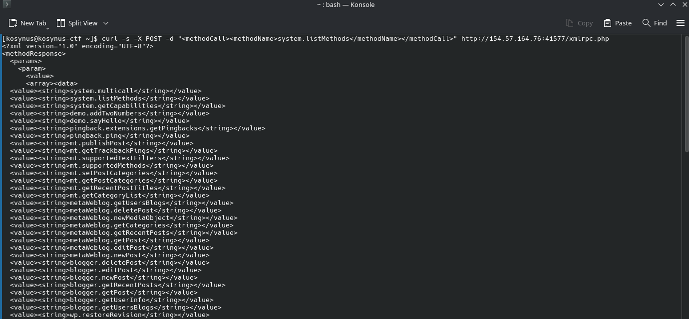
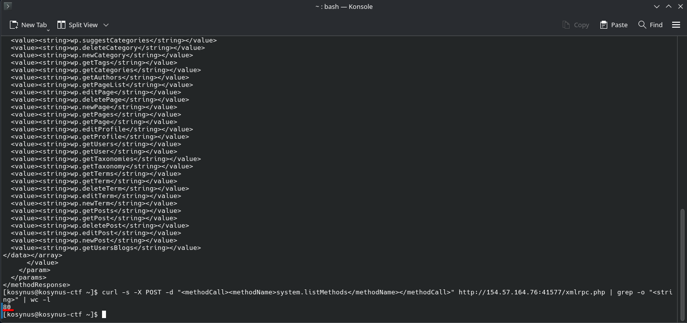

**Platform:**  HackTheBox Academy
**Category:**  Hacking WordPress
**Difficulty:**  Easy
**Date:** 2026-11-08  
**Tags:** htb academy, hacking wordpress

---

## Reconnaissance

1. Search for "WordPress xmlrpc attacks" and find out how to use it to execute all method calls. Enter the number of possible method calls of your target as the answer.

First we will send a post request to the server in order to find out if there are any available methods to call



Looks like there are some, we will not count them manually but use some pipelines that will do that job for us




```bash
curl -s -X POST -d "<methodCall><methodName>system.listMethods</methodName></methodCall>" http://154.57.164.76:41577/xmlrpc.php | grep -o "<stri  
ng>" | wc -l
```

## Flag / Root

1. `80`