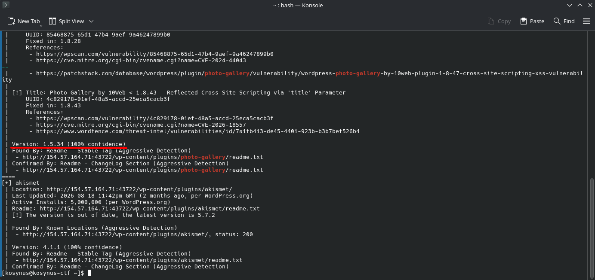

**Platform:**  HackTheBox Academy
**Category:**  Hacking WordPress
**Difficulty:**  Easy
**Date:** 2026-11-08  
**Tags:** htb academy, hacking wordpress

---

## Reconnaissance

1. Enumerate the provided WordPress instance for all installed plugins. Perform a scan with WPScan against the target and submit the version of the vulnerable plugin named “photo-gallery”.

In order to do this we will use `wpscan`, but we will not run a simple scan because there are propably many vulnerable plugins on this wordpress instance, so we will have to filter them out and reach for what the question asks us, we will also need an account on `wpscan` website in order to get a token



```bash
wpscan --url http://154.57.164.71:43722 -e p --plugins-detection aggressive | grep -A 15 photo-gallery
```

## Flag / Root

1. `1.5.34`